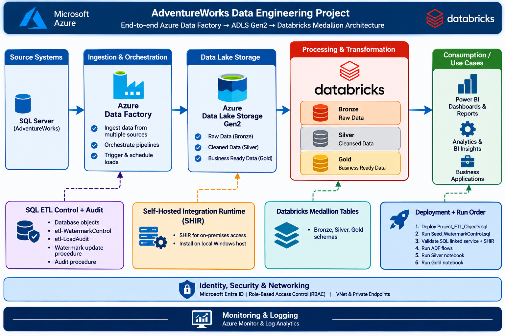

# Medallion architecture

This is the Azure-to-Databricks flow used in the project.

## Current flow

1. Azure Data Factory copies source SQL Server tables into the ADLS `bronze` container as Parquet. The metadata-driven pipeline reads active rows from `etl.WatermarkControl` and branches on `LoadType`: a full load writes the configured baseline file; after a successful copy, the watermark procedure changes the row to incremental mode, which writes run-specific files under `incremental/`. A separate Product full-load pipeline is also retained for the historical standalone test.
2. The Bronze notebook checks connectivity and inventories the four source folders: Customer, SalesOrderHeader, SalesOrderDetail, and Product.
3. The Silver notebook reads Bronze Parquet, checks and deduplicates source data, and creates Delta tables in `adb_adventureworks_dev.silver`.
4. The Gold notebook reads the Silver tables and creates date/customer/product dimensions and sales facts in `adb_adventureworks_dev.gold`.

The watermark and audit tables and procedures are defined in the SQL deployment script. `Control_Tables/Seed_WatermarkControl.sql` supplies initial full-load configuration for Customer, SalesOrderHeader, SalesOrderDetail, and Product. Use `Reset_WatermarkControl_For_Full_Load.sql` only after verifying that the Bronze destination is empty or that replacing its baseline files is intended.

## Deployment prerequisites

- Deploy `02_SQL_Server/Database_Scripts/Project_ETL_Objects.sql`, then run `02_SQL_Server/Control_Tables/Seed_WatermarkControl.sql`.
- Configure and validate the SQL Server linked service and the self-hosted integration runtime before running the ADF pipelines.
- Confirm ADLS permissions for the ADF identity and Databricks identity. The notebooks use the `awdata2022` storage account and `bronze` container as their current default.
- Ensure the Databricks workspace can use the `adb_adventureworks_dev` catalog and create/use its `silver` and `gold` schemas.
- Run the ADF loads before Silver, then run Silver before Gold.

No trigger is configured. A schedule or event trigger should be added only after the cadence, time zone, and late-arriving-data policy are decided. Product is included in the metadata seed because the recorded incremental run also copied Product.
