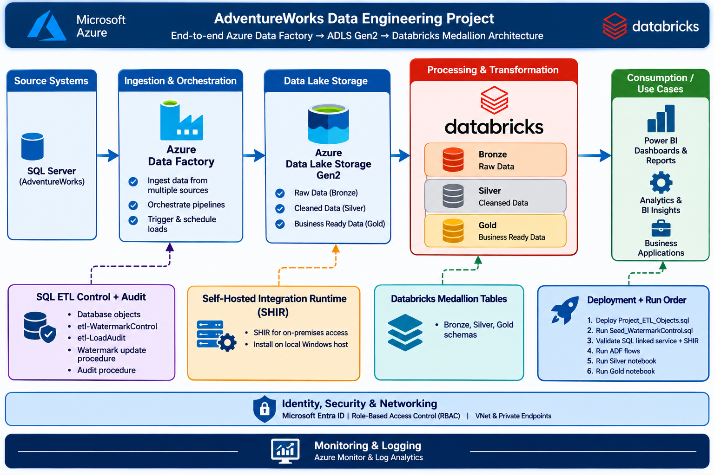

# AdventureWorks Azure-to-Fabric migration project

Built a pipeline from local SQL Server through ADF and SHIR into ADLS Bronze, transformed the data in Databricks Silver and Gold, and recorded tests for each stage. The Azure environment was later deleted, so this backup brings together the project files and results from that work; the cloud tests have not been rerun during this local review.

## Architecture

SQL Server 2022 (`AdventureWorks2022`) -> Azure Data Factory + Self-hosted Integration Runtime -> ADLS Gen2 Bronze (Parquet) -> Databricks Silver (Delta) -> Gold dimensions and facts.

The Microsoft Fabric migration has not started. The [remaining-work backlog](05_Documentation/Project_Progress/Remaining_Work_Backlog.md) records what is still ahead.

## Project folders

| Folder | Contents |
|---|---|
| `01_Azure_Data_Factory` | ADF pipeline/dataset/linked-service exports, ARM templates, and runtime notes |
| `02_SQL_Server` | SQL ETL objects, watermark seed, audit diagnostics, and AdventureWorks backup |
| `03_Databricks` | Layer notebooks, cluster snapshot, Unity Catalog setup, and validation SQL |
| `04_Data` | Local Bronze, Silver, and Gold Parquet snapshots |
| `05_Documentation` | Architecture, testing evidence, lessons, troubleshooting, and follow-up work |
| `06_Resource_Inventory` | Historical resource names and cloud lifecycle status |

## Rebuild steps

The [step-by-step rebuild runbook](05_Documentation/Project_Progress/Rebuild_Runbook.md) takes the project from backup verification and local SQL restore through Azure/SHIR setup, ADF deployment and testing, Databricks/Unity Catalog setup, notebook execution, and validation. It also tracks the remaining modelling, production, and Fabric work.

Before rebuilding Azure, confirm the subscription, region, resource-group contents, access, cost controls, and deployment settings. No credentials or secrets are stored in this repository.

## Historical testing results

The historical ADF, Silver, Gold, Spark, and troubleshooting results are in [Testing_Results](05_Documentation/Testing_Results/). The Customer Copy/audit mismatch, inclusive watermark behavior, and equal-timestamp merge limitation remain open.
